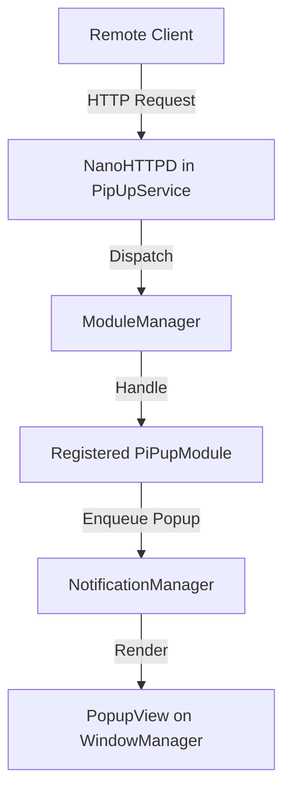

# PiPup Architecture Overview

PiPup follows a strict modular "Docking" architecture. The core system is designed to be "blind" to specific module implementations, providing only the necessary infrastructure for modules to register their functionality.

## Core Components

### 1. PipUpService

The main background service (`PipUpService.kt`) hosts the NanoHTTPD web server and manages the `NotificationManager`. It acts as the primary entry point for all remote requests, delegates module routes to the `ModuleManager`, renders the browser landing page via `LandingPageRenderer.kt`, and handles `/settings` synchronization via `SettingsApiHandler.kt`.

### 2. ModuleManager

The `ModuleManager.kt` is the brain of the modular system. It:

- Maintains a registry of all available `PiPupModule` instances.
- Manages module lifecycles (ON, OFF, ECO).
- Dispatches HTTP requests to the appropriate module based on `supportedRoutes`.
- Augments the global `/state` response with module-specific data.

### 3. NotificationManager & Popup UI

Responsible for the display queue, multi-popup stacking (up to `maxPopups`), and overlay view lifecycle:

- `NotificationManager.kt` coordinates the FIFO queue, in-place updates, and cancellation, delegating 2D placement and atomic eviction to `PopupLayoutSimulator.kt`, `WindowManager` overlay/container management to `PopupOverlayHost.kt`, and slot preparation/display/removal to `PopupSlotPresenter.kt`.
- `PopupView.kt` renders each notification using `PopupLayoutController.kt` (full-bleed, fullscreen, auto-scroll) and `PopupButtonController.kt` (action buttons and overlay close button).
- `MediaRenderer.kt` coordinates media playback and aggressive resource cleanup across lazily instantiated `ImageMediaRenderer.kt` (Glide/bitmaps/posters), `VideoMediaRenderer.kt` (Media3 ExoPlayer/RTSP), and `WebMediaRenderer.kt` (WebView/WHEP).

## Data Flow

## UI Registry & Docking

In the `SettingsActivity.kt`, a centralized `moduleSubmenuFactories` registry is used to map layout resources to specialized UI controllers.

- Modules can provide a custom `layoutRes` in their `ModuleMenuDefinition`.
- The Activity creates the corresponding controller (e.g., `VendorSubmenu`) without knowing about the module's identity.
- If no custom layout is provided, the generic `ModuleSubmenu` is used.

## Design Principles

- **The Core is Blind:** No `if (moduleId == "...")` checks or hardcoded module queries (`getModule("...")`) are allowed in the core or UI classes.
    - To interact with modular features, the Core defines capability interfaces (e.g. `PeerDiscoveryProvider`) and queries `moduleManager.getActiveCapability<T>()`.
    - Modules hook into UI events via polymorphic callbacks (e.g. `onModeToggled(context, newMode)`).
- **Resource Efficiency:** Modules in `ECO` mode are unloaded when idle to save RAM on Android TV devices.
- **Centralized Permissions:** Permission checks, system intents, diagnostics, and ADB commands live in `Permissions.kt`, while UI labels, descriptions, and guided fix dialogs live in `PermissionsUi.kt`; visibility is driven by module requirements.

## State Model & API Contract Design

PiPup follows two key principles for remote API interaction and state visibility:

### 1. API Contract First

All endpoints, parameters, HTTP status codes, and JSON response bodies are strictly specified in `docs/api.md` and enforced by automated contract tests (`NotificationApiTest`).

### 2. 4-Layer State Model

Instead of relying on a single generic success response, PiPup exposes execution states across 4 distinct layers:

1. **Transport Layer (HTTP):** Validates payload syntax and size limits, returning HTTP status codes (`200 OK: Enqueued`, `400 Bad Request`).
2. **Display Layer (TV Overlay):** Tracks active visual overlays on screen via `visible`, `popup`, and the `popups` stack array in `/state`, alongside real-time `popup_shown` and `popup_removed` push events.
3. **Media Playback Layer:** Tracks stream and image loading status via `mediaError` on popup instances and renders fallback placeholders on loading failures.
4. **System & Update Layer:** Exposes system permissions and self-update progress (`update.phase`, `update.error`, `permissions`).
